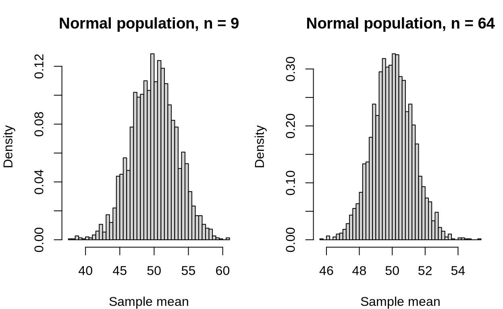
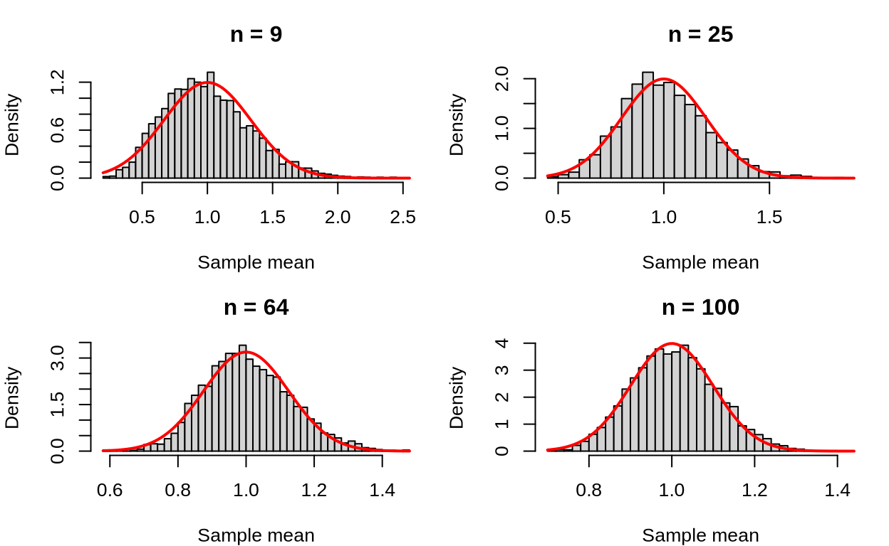

A network engineering team is studying packet sizes on a campus link.
The distribution is bimodal: many small control packets and many larger
data packets, with relatively few packets in between. A cybersecurity
analyst is studying counts of alerts per hour. A robotics team is
calibrating a sensor whose measurement noise is approximately normal. In
each case, someone wants to use the sample mean and needs to know
whether a normal model is reasonable.

The central limit theorem (CLT) is the result that often makes a normal
model reasonable. But the CLT is not automatic. It depends on the
population and especially on the sample size. The goal of this reading
is to make those conditions concrete.

## What the central limit theorem says

In words, the central limit theorem says that for independent
observations from a population with finite mean and finite standard
deviation, the sampling distribution of the sample mean becomes
approximately normal as the sample size grows.

More formally, let $`X_1,\ldots,X_n`$ be independent observations with
mean $`\mu`$ and standard deviation $`\sigma`$. For large $`n`$,

``` math
Z_n=\frac{\bar X-\mu}{\sigma/\sqrt n}
```

is approximately a standard normal random variable. Equivalently,

``` math
\frac{\bar X-\mu}{\sigma/\sqrt n}\overset{\text{approx.}}{\sim}\operatorname{Normal}(0,1).
```

We can rearrange this as

``` math
\bar X=\mu+\frac{\sigma}{\sqrt n}Z_n.
```

This is a linear transformation of an approximately standard normal
variable. From the linear transformations material earlier in the
course, if $`Z\sim\operatorname{Normal}(0,1)`$, then
$`a+bZ\sim\operatorname{Normal}(a,b^2)`$. Here $`a=\mu`$ and
$`b=\sigma/\sqrt n`$, so $`\bar X`$ is approximately normal with mean
$`\mu`$ and standard error $`\sigma/\sqrt n`$.

The theorem is about the shape of the sampling distribution of
$`\bar X`$. It does not say that the raw data become normal. It does not
say that every sample mean is close to $`\mu`$. It does not remove bias
from a bad sampling plan.

The standard version of the theorem assumes:

- the observations are independent, or nearly enough for the
  approximation to be reasonable;
- the observations come from the same population distribution;
- the population has a finite mean and finite standard deviation;
- the sample size is large enough for the approximation to be useful.

The last condition is the one that requires judgment. “Large enough”
depends on how far the population is from normal. A roughly symmetric
population may look normal in the sampling distribution even for fairly
small samples. A strongly skewed or strongly bimodal population may need
a larger sample.

## What changes and what does not

The CLT changes the shape of the sampling distribution as $`n`$ grows.
It does not change the center or the formula for the standard error.

- **Center:** $`E(\bar X)=\mu`$, regardless of $`n`$.
- **Spread:** $`\operatorname{SE}(\bar X)=\sigma/\sqrt n`$, regardless
  of the population shape.
- **Shape:** increasingly close to normal as $`n`$ grows when the CLT
  applies.

The center and standard error require only $`\mu`$, $`\sigma`$, and
$`n`$; they do not require knowing the full population distribution. The
population shape matters for deciding whether the normal approximation
is justified.

This separation matters. A larger sample gives a narrower sampling
distribution, but it does not move the sampling distribution toward a
different mean. If a measurement process is biased, a larger sample will
estimate the biased population mean more precisely, not the quantity we
wish we were measuring.

## When the population is already normal

If the population distribution is normal, the sampling distribution of
$`\bar X`$ is exactly normal for every sample size. The CLT is not
needed. The sample size still controls the standard error, but it does
not control whether the shape is normal.

This matters for the assessments. A scenario can use a very small sample
from a normal population and still justify a normal model for the sample
mean. The reason is the normal population, not the CLT.

``` r
# Set a seed so the simulated population and sample means are reproducible.
set.seed(390)

# Generate a large population that is exactly normal with mean 50 and SD 10.
normal_pop <- rnorm(200000, mean = 50, sd = 10)

# Draw 3,000 samples of size 9 and compute each sample mean.
small_means <- replicate(3000, mean(sample(normal_pop, 9)))

# Draw 3,000 samples of size 64 and compute each sample mean.
large_means <- replicate(3000, mean(sample(normal_pop, 64)))

# Prepare a one-row, two-column plotting area.
par(mfrow = c(1, 2), mar = c(4, 4, 3, 1))

# Plot the sample means from the small samples. The shape should look normal
# because the population itself is normal, even though n = 9 is small.
hist(
  small_means,
  breaks = 35,
  freq = FALSE,
  main = "Normal population, n = 9",
  xlab = "Sample mean"
)

# Plot the sample means from the large samples. The distribution should also
# look normal, but it should be narrower because the standard error is smaller.
hist(
  large_means,
  breaks = 35,
  freq = FALSE,
  main = "Normal population, n = 64",
  xlab = "Sample mean"
)
```



Both histograms look normal. The larger sample is narrower, but the
shape has not fundamentally changed.

## When the population is not normal

When the population is strongly skewed, bimodal, or otherwise clearly
nonnormal, the sample size determines whether the normal approximation
is safe.

For this course, we use a simple guideline:

- If $`n>30`$, treat the sample as large enough for the CLT to make the
  sampling distribution approximately normal when the population is
  clearly nonnormal.
- If $`n\le30`$, do not rely on the CLT for a clearly nonnormal
  population.

This is a course guideline, not a law of nature. The CLT is an
approximation, and the quality of the approximation depends on the
population. A very extreme distribution may require a larger sample than
a mildly skewed one.

The next simulation draws from a strongly right-skewed population and
shows the sampling distribution at several sample sizes.

``` r
# Set a seed so the simulation is reproducible.
set.seed(390)

# Generate a large strongly right-skewed population using an exponential
# distribution with rate 1. The population mean and standard deviation are
# both 1, but the population is far from normal.
skew_pop <- rexp(200000, rate = 1)

# Prepare a two-by-two plotting area for four sample sizes.
par(mfrow = c(2, 2), mar = c(4, 4, 3, 1))

# Repeat the sampling experiment for several sample sizes.
for (n in c(9, 25, 64, 100)) {
  # Draw 4,000 samples of size n and compute the mean of each sample.
  means <- replicate(4000, mean(sample(skew_pop, n, replace = TRUE)))

  # Plot the 4,000 sample means. This approximates the sampling distribution
  # of the sample mean for this sample size.
  hist(means, breaks = 40, freq = FALSE,
       main = paste("n =", n), xlab = "Sample mean")

  # Overlay the normal curve predicted by the CLT: mean 1 and standard
  # error 1/sqrt(n). Comparing the histogram to this curve shows how the
  # sampling distribution becomes more normal as n grows.
  curve(dnorm(x, mean = 1, sd = 1 / sqrt(n)), add = TRUE, col = "red", lwd = 2)
}
```



At $`n=9`$, the sampling distribution is still visibly right-skewed. By
$`n=64`$ and $`n=100`$, it is close to normal.

## Deciding whether the CLT applies

When you face a scenario, ask three questions in order.

1.  **What is the shape of the population?** If it is approximately
    normal, a normal model for the sample mean is justified for any
    sample size. The CLT is not needed.
2.  **If the population is not normal, how large is the sample?** If
    $`n\le30`$, do not rely on the CLT. If $`n>30`$, the CLT generally
    justifies an approximately normal sampling distribution.
3.  **Are the observations independent?** The CLT does not rescue
    dependent observations. Repeated measurements on the same unit or
    samples collected in clusters can invalidate the usual
    standard-error formula and the normal approximation.

It also helps to look at the data. A histogram of a pilot sample can
reveal strong skew, outliers, or multiple modes. A small pilot sample
may be too small to reveal the population shape reliably, so use that
information with caution.

## Worked examples

**Example 1: strongly skewed session lengths.** A web analytics team
studies session lengths. The population is strongly right-skewed. A
random sample of $`n=100`$ sessions is selected. Because the sample is
large and the observations are independent, the CLT justifies an
approximately normal model for the sample mean. The mean of the sampling
distribution is the population mean session length, and the standard
error is $`\sigma/\sqrt{100}`$.

**Example 2: left-skewed repair times.** A maintenance team studies
repair times that are strongly left-skewed. A random sample of $`n=16`$
repairs is selected. The sample is too small to rely on the CLT for such
a nonnormal population. A normal model for the sample mean is not
justified by the CLT, even though the sample mean is still centered at
the population mean and has standard error $`\sigma/\sqrt{16}`$.

**Example 3: normal sensor noise.** A robotics team knows from
calibration that sensor error is approximately normally distributed. A
random sample of $`n=20`$ readings is selected. The sampling
distribution of the sample mean is approximately normal because the
population is normal, not because of the CLT. The sample size affects
only the standard error.

**Example 4: bimodal packet sizes.** A network team studies packet sizes
that are bimodal. A random sample of $`n=81`$ packets is selected. Even
though the population is not normal, the sample is large enough for the
CLT to make the sampling distribution of the mean approximately normal.

## Common mistakes

- **Thinking $`n>30`$ makes the raw data normal or fixes a biased
  sample.** The CLT concerns the sampling distribution of the sample
  mean, not the raw data, and it does not remove bias.
- Using the CLT when the population is already normal. In that case, the
  sampling distribution is normal without invoking the CLT.
- Thinking the CLT fixes bias. A large sample from a biased sampling
  frame still estimates the wrong population quantity.
- Thinking the CLT changes the mean or standard error. It changes the
  shape of the sampling distribution; the center and standard error
  follow their own formulas.
- **Ignoring dependence.** Observations from the same cluster, repeated
  measurements, or time series can violate the independence assumption.

## A decision guide

| Population shape | Sample size | Normal model for $`\bar X`$? | Reason |
|----|---:|----|----|
| Approximately normal | Any | Yes | Population is normal |
| Clearly nonnormal | $`n\le30`$ | Not safely | CLT does not apply reliably |
| Clearly nonnormal | $`n>30`$ | Yes, approximately | CLT applies |
| Any shape | Any | Check independence first | Dependence can invalidate the model |

The central limit theorem is powerful because it lets us use a normal
model even when the population is not normal. But it is a conditional
tool, not a universal switch. The population shape and the sample size
jointly determine when it is reasonable.
