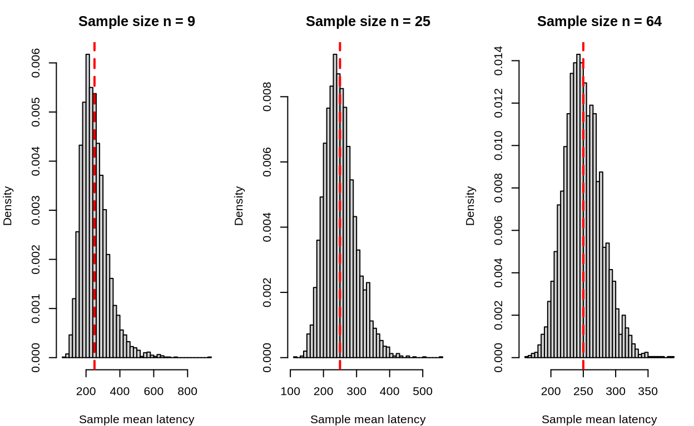
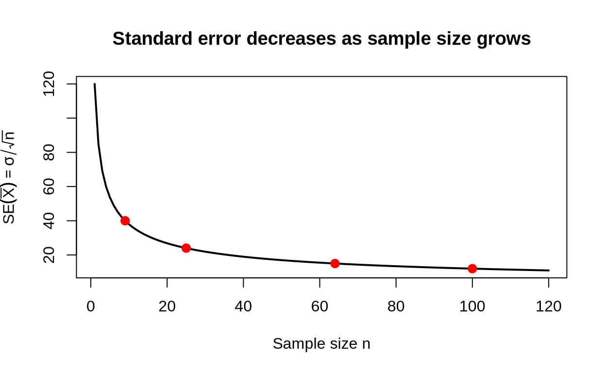
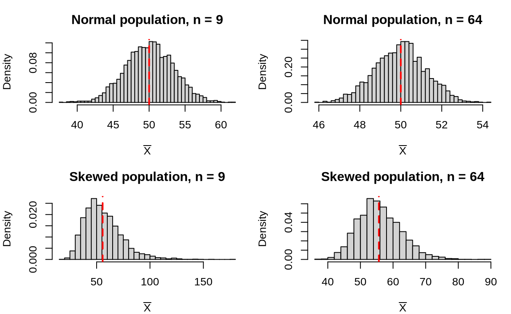

A platform team is benchmarking a new database service. Latency is
measured for a random set of queries, and the team computes the average
latency. They run the benchmark again with a different random set of
queries and get a different average. The same thing happens on a third
run. Individual query times are highly variable, and the average is not
identical from run to run.

This is not a flaw in the benchmark. It is a fundamental feature of
sampling. Whenever we summarize a random sample with a statistic such as
the sample mean, that statistic is itself random. Understanding how it
varies is the key to interpreting data and to the inference methods that
come later in the course.

In this reading we study the sampling distribution of the sample mean.
We will see where its center comes from, why its spread shrinks as the
sample size grows, and why its shape depends on both the population and
the sample size.

## Population, sample, and statistic

Three distributions are easy to confuse.

- The population distribution describes the values of the variable
  across the entire population. In the latency example, it describes how
  long every possible query takes.
- The sample distribution describes the values we actually observed. It
  is the histogram of the data in one sample.
- The sampling distribution describes the values of a statistic over
  repeated random samples of the same size. It is the histogram we would
  see if we could repeat the study many times.

The population distribution is fixed. The sample distribution changes
from sample to sample. The sampling distribution describes that
sample-to-sample variability.

For a sample $`X_1,\ldots,X_n`$, the sample mean is

``` math
\bar X=\frac{1}{n}\sum_{i=1}^n X_i.
```

The sample mean is a statistic: a number computed from the sample.
Before the data are observed, it is a random variable. After the data
are observed, it is a number such as $`\bar x=236.4`$ milliseconds.

A random sample means that the observations are independent and come
from the same population distribution. Independence is important because
it lets us combine information across observations. It also underlies
the formulas for the center and spread of the sampling distribution.

## Simulating the sampling distribution

One of the best ways to understand a sampling distribution is to
simulate one. Suppose the population of query latencies is strongly
right-skewed with a long upper tail. We can generate a large population
in R, draw many samples of size $`n`$, and plot the sample means.

``` r
# Set a seed so the simulated population and sample means are reproducible.
set.seed(390)

# Generate a very large population of query latencies from a log-normal
# distribution. The log-normal shape gives the strong right skew we want.
population <- rlnorm(200000, meanlog = 5.2, sdlog = 0.8)

# Choose the sample sizes to compare.
sample_sizes <- c(9, 25, 64)

# Prepare a one-row, three-column plotting area.
par(mfrow = c(1, 3), mar = c(4, 4, 3, 1))

# Repeat the sampling experiment for each sample size.
for (n in sample_sizes) {
  # Draw 4,000 sample means, each based on n observations.
  many_means <- replicate(
    4000,
    mean(sample(population, n, replace = TRUE))
  )

  # Plot the sample means. This histogram approximates the sampling
  # distribution of the sample mean for this sample size.
  hist(
    many_means,
    breaks = 40,
    freq = FALSE,
    main = paste("Sample size n =", n),
    xlab = "Sample mean latency"
  )

  # Mark the true population mean with a dashed vertical line.
  abline(v = mean(population), col = "red", lwd = 2, lty = 2)
}
```



The histograms are centered near the population mean, and they are much
narrower than the population distribution. They are also much more
symmetric than the original latency distribution. The next sections
explain each of those observations.

## The center of the sampling distribution

The sample mean is unbiased: its expected value is the population mean.
To see why, use linearity of expectation:

``` math
E(\bar X)
= E\left(\frac{1}{n}\sum_{i=1}^n X_i\right)
= \frac{1}{n}\sum_{i=1}^n E(X_i)
= \frac{1}{n}\sum_{i=1}^n \mu
= \mu.
```

Linearity lets us move the expectation through the sum and pull out the
constant $`1/n`$. Each observation has the same population mean $`\mu`$,
so the sum contains $`n`$ copies of $`\mu`$.

This says that if we repeated the study many times, the average of the
sample means would equal the population mean. Individual samples may
produce means above or below $`\mu`$, but there is no systematic
tendency to land on one side.

Unbiasedness does not mean that every sample mean is close to $`\mu`$.
It only means that the long-run center is correct. A single small sample
can still be far from the population mean, especially when the
population is highly variable.

In the latency example, if the population mean latency is $`\mu=250`$
milliseconds, then the sampling distribution of $`\bar X`$ is centered
at $`250`$ milliseconds for every sample size. Changing $`n`$ does not
move the center.

## The spread of the sampling distribution

The variability of the sample mean is measured by its standard error:

``` math
\operatorname{SE}(\bar X)=\frac{\sigma}{\sqrt n},
```

where $`\sigma`$ is the population standard deviation and $`n`$ is the
sample size. To see where the variance formula comes from, write

``` math
\operatorname{Var}(\bar X)
= \operatorname{Var}\left(\frac{1}{n}\sum_{i=1}^n X_i\right)
= \frac{1}{n^2}\sum_{i=1}^n \operatorname{Var}(X_i)
+ \frac{2}{n^2}\sum_{i<j}\operatorname{Cov}(X_i,X_j).
```

Because the observations are independent,
$`\operatorname{Cov}(X_i,X_j)=0`$ for every pair with $`i\neq j`$. The
covariance terms therefore vanish, and each
$`\operatorname{Var}(X_i)=\sigma^2`$, so

``` math
\operatorname{Var}(\bar X)
= \frac{1}{n^2}\sum_{i=1}^n \sigma^2
= \frac{n\sigma^2}{n^2}
= \frac{\sigma^2}{n}.
```

Taking the square root gives the standard error.

The standard error is a standard deviation, but it describes the
variability of a statistic rather than the variability of individual
observations. It has the same units as the original data.

For a population with $`\sigma=120`$ milliseconds, the standard error
changes as follows.

| Sample size $`n`$ | Standard error $`\sigma/\sqrt n`$ |
|------------------:|----------------------------------:|
|                 9 |                   $`120/3=40`$ ms |
|                25 |                   $`120/5=24`$ ms |
|                64 |                   $`120/8=15`$ ms |
|               100 |                  $`120/10=12`$ ms |

Larger samples give more precise estimates. Quadrupling the sample size
cuts the standard error in half, because the square root of $`4`$ is
$`2`$.

``` r
# Set the population standard deviation.
sigma <- 120

# Choose a range of sample sizes.
n <- 1:120

# Compute the standard error for each sample size.
standard_error <- sigma / sqrt(n)

# Plot the standard error curve.
plot(
  n,
  standard_error,
  type = "l",
  lwd = 2,
  xlab = "Sample size n",
  ylab = expression(SE(bar(X)) == sigma / sqrt(n)),
  main = "Standard error decreases as sample size grows"
)

# Add points for a few specific sample sizes.
points(
  c(9, 25, 64, 100),
  sigma / sqrt(c(9, 25, 64, 100)),
  pch = 19,
  col = "red",
  cex = 1.2
)
```



## The shape of the sampling distribution

The center and spread are simple. The shape is more subtle.

If the population is exactly normal, then the sampling distribution of
$`\bar X`$ is exactly normal for every sample size. The sample size
changes the spread but not the shape.

If the population is not normal, the sampling distribution may not look
normal when the sample is small. For larger samples, it often becomes
approximately normal. That is the central limit theorem, which is the
focus of the next reading.

For now, the important idea is that the shape of the sampling
distribution is not automatically the shape of the population. The
distribution of individual query latencies can be strongly right-skewed
while the distribution of sample means is nearly symmetric.

The following simulation compares sample means from a normal population
with sample means from a strongly right-skewed population. Both are
shown for a small sample and a large sample.

``` r
# Set a seed so both simulated populations are reproducible.
set.seed(390)

# Generate a large normal population with mean 50 and standard deviation 10.
normal_pop <- rnorm(200000, mean = 50, sd = 10)

# Generate a large right-skewed population using a log-normal distribution.
skew_pop <- rlnorm(200000, meanlog = 3.7, sdlog = 0.8)

# For each population, draw 3,000 samples of size 9 and size 64.
# Each replicate() call returns one sample mean.
means_normal_small <- replicate(3000, mean(sample(normal_pop, 9)))
means_normal_large <- replicate(3000, mean(sample(normal_pop, 64)))
means_skew_small <- replicate(3000, mean(sample(skew_pop, 9)))
means_skew_large <- replicate(3000, mean(sample(skew_pop, 64)))

# Prepare a two-by-two plotting area for the four sampling distributions.
par(mfrow = c(2, 2), mar = c(4, 4, 3, 1))

# Plot sample means from the normal population at n = 9.
hist(
  means_normal_small,
  breaks = 35,
  freq = FALSE,
  main = "Normal population, n = 9",
  xlab = expression(bar(X))
)
abline(v = mean(normal_pop), col = "red", lwd = 2, lty = 2)

# Plot sample means from the normal population at n = 64.
hist(
  means_normal_large,
  breaks = 35,
  freq = FALSE,
  main = "Normal population, n = 64",
  xlab = expression(bar(X))
)
abline(v = mean(normal_pop), col = "red", lwd = 2, lty = 2)

# Plot sample means from the skewed population at n = 9.
hist(
  means_skew_small,
  breaks = 35,
  freq = FALSE,
  main = "Skewed population, n = 9",
  xlab = expression(bar(X))
)
abline(v = mean(skew_pop), col = "red", lwd = 2, lty = 2)

# Plot sample means from the skewed population at n = 64.
hist(
  means_skew_large,
  breaks = 35,
  freq = FALSE,
  main = "Skewed population, n = 64",
  xlab = expression(bar(X))
)
abline(v = mean(skew_pop), col = "red", lwd = 2, lty = 2)
```



The normal population produces a bell-shaped sampling distribution even
at $`n=9`$. The skewed population produces a noticeably skewed
distribution at $`n=9`$, but the distribution of sample means is much
closer to normal at $`n=64`$.

## A worked latency example

Suppose a service has population mean latency $`\mu=250`$ ms and
population standard deviation $`\sigma=120`$ ms. A random sample of
$`n=64`$ requests is collected, and the sample mean $`\bar X`$ is
computed.

- The sampling distribution is centered at $`250`$ ms.
- Its standard error is $`120/\sqrt{64}=15`$ ms.
- Because $`n=64`$ is large and the population is not extremely well
  behaved, we would expect the sampling distribution to be approximately
  normal, provided the observations are independent and there are no
  extreme distortions.

If the team instead used $`n=100`$, the center would remain $`250`$ ms,
but the standard error would drop to $`120/10=12`$ ms. More data gives a
more precise estimate, not a different center.

## Common mistakes

Watch for these errors when reasoning about sample means.

- Confusing the population distribution with the sampling distribution.
  The histogram of the raw data and the histogram of the sample means
  are different objects.
- **Using $`\sigma`$ instead of $`\sigma/\sqrt n`$.** The standard
  deviation of individual observations is not the standard error of the
  sample mean.
- **Thinking larger samples change the center.** The sample mean is
  centered at $`\mu`$ for every sample size.
- **Thinking the sample mean is always exactly normal.** That is true
  for a normal population, but not automatically for every population
  and sample size.
- **Treating observations as independent when they are not.** Repeated
  measurements on the same unit, clustered data, or time-ordered data
  can violate the independence assumption.

## Putting the pieces together

The sample mean is a random variable. Its sampling distribution has
center $`\mu`$, standard error $`\sigma/\sqrt n`$, and a shape that
depends on the population and the sample size. Computing the center and
standard error requires only $`\mu`$, $`\sigma`$, and $`n`$; the full
population distribution is not needed for those two quantities. The
population shape matters only for the shape of the sampling
distribution. These three facts are the foundation for the central limit
theorem and for the confidence intervals and tests that come later.
